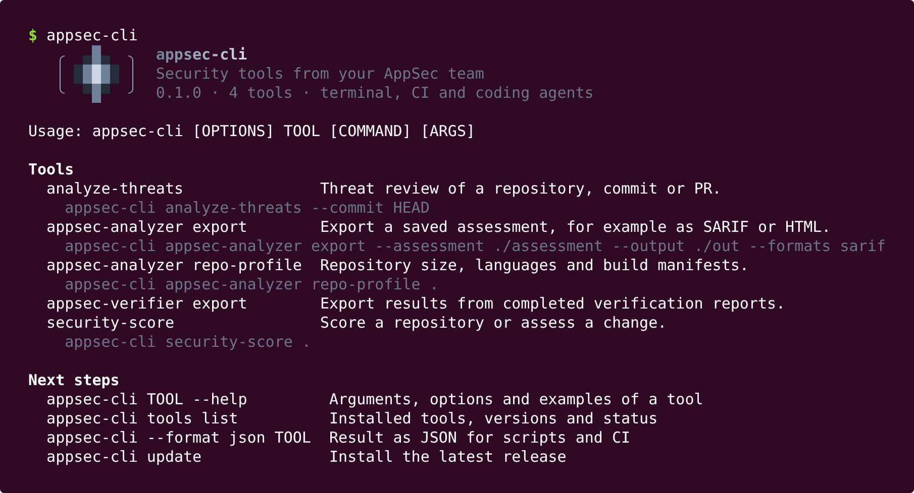

# appsec-cli

[](pyproject.toml)
[](#appsec-cli)
[](pyproject.toml)
[](LICENSE)
[](https://docs.oasis-open.org/sarif/sarif/v2.1.0/sarif-v2.1.0.html)

> [!NOTE]
> **Alpha.** Early version, actively developed. Tested on Linux x86_64 with Python 3.12 and Git.

appsec-cli gives development teams the security tools of their AppSec team in one command-line tool. Developers install it once and call every tool the same way, in the terminal, in CI, or from a coding agent. The AppSec team decides which tools go into a release.

<picture>
  <source media="(prefers-color-scheme: dark)" srcset="docs/images/start-page-dark.png">
  
</picture>

This repository contains an example setup built on tools from [appsec-foundry](https://github.com/appsec-foundry): [Security Score](https://github.com/appsec-foundry/appsec-tools/tree/main/security-score), [AppSec Analyzer](https://github.com/appsec-foundry/appsec-analyzer), [AppSec Verifier](https://github.com/appsec-foundry/appsec-verifier), and [Requirement Harvester](https://github.com/appsec-foundry/appsec-tools/tree/main/requirement-harvester). Replace them with your own tools or add more.

appsec-cli has no server and no package index of its own. The tools run on the developer's machine or the CI runner. Of the example tools, only `analyze-threats` sends source code to a model provider; see [Data use](#model-profiles-and-data-use).

[Quick start](#quick-start) · [How it works](#how-it-works) · [Example setup](#example-setup) · [For development teams](#for-development-teams) · [CI](#use-in-ci) · [Data use](#model-profiles-and-data-use) · [Add a tool](#add-your-own-tool) · [Release](#release-and-distribution) · [Configuration](#configuration)

## Quick start

You need Linux x86_64, Python 3.12, Git, [pipx](https://pipx.pypa.io/stable/), access to PyPI, and read access to the appsec-foundry repositories on GitHub.

1. **Install the example setup:**

   ```sh
   git clone https://github.com/appsec-foundry/appsec-cli.git
   cd appsec-cli
   make install
   ```

   `make install` builds the engines at pinned commits, checks the hashes of all other dependencies, and installs everything with pipx. Run it again after each `git pull`.

2. **Try it:**

   ```sh
   appsec-cli                              # tools with an example call each
   appsec-cli security-score /path/to/app  # score a repository
   ```

3. **Give it to your development teams.** Publish the release in your package index as described in [Release and distribution](#release-and-distribution). Developers then install it with `pipx install appsec-cli`.

## How it works

A release consists of Python packages that pipx installs into one environment:

| Package | Contents | Location |
| --- | --- | --- |
| `appsec-cli` | The suite that teams install. It pins the versions of all packages in a release. | This repository |
| `appsec-cli-core` | Help, tool discovery, configuration, output formats, and exit codes. | [core/](core) |
| `appsec-plugin-<tool>` | Adapter for one tool. Defines its command and converts its output into the common result format. | `tools/<tool>/` or its own repository |
| Engine | The tool itself, such as `appsec-security-score`. | Its own repository |

Each directory in [tools/](tools) is one tool, and the release build picks them all up. appsec-cli loads a tool's code only when the tool runs, so one broken tool does not affect the others.

## Example setup

The example tools come from appsec-foundry. Each one is a Python adapter in [tools/](tools).

| Command | What it does | Built on | Model calls |
| --- | --- | --- | --- |
| `security-score [REPO]` | Scores a local repository or a GitHub or GitLab repository by its HTTPS URL. With `--commit SHA` or `--staged`, it rates how security-relevant a change is. | [Security Score](https://github.com/appsec-foundry/appsec-tools/tree/main/security-score) 0.3.4 | No |
| `analyze-threats [REPO]` | Threat review of `HEAD`, a commit (`--commit SHA`), the changes since a base commit (`--base SHA`), or a GitHub pull request (`--pr URL`), with cited evidence. | [AppSec Analyzer](https://github.com/appsec-foundry/appsec-analyzer) 0.1.0a0 | Yes |
| `appsec-analyzer assess --repo REPO` | Full security assessment of a local repository or a Git URL, within a cost limit. The reports go to `--output`, SARIF and HTML on request (`--sarif`, `--html`). Runs only in the terminal. | [AppSec Analyzer](https://github.com/appsec-foundry/appsec-analyzer) 0.1.0a0 | Yes |
| `appsec-analyzer repo-profile [REPO]` | Size, languages, and build manifests of a repository. | [AppSec Analyzer](https://github.com/appsec-foundry/appsec-analyzer) 0.1.0a0 | No |
| `appsec-analyzer export --assessment DIR --output NEW_DIR` | Converts a finished assessment, for example to SARIF (`--formats sarif`), HTML (`--formats html`, needs Pandoc), or PDF. `NEW_DIR` lies outside Git checkouts. | [AppSec Analyzer](https://github.com/appsec-foundry/appsec-analyzer) 0.1.0a0 | No |
| `appsec-verifier export VERIFICATION_YAML` | Checks a finished AppSec Verifier report and exports its findings with verdict and confidence. | Report schema of [AppSec Verifier](https://github.com/appsec-foundry/appsec-verifier) | No |
| `requirement-harvester run --config FILE` | Reads requirements from web pages and wikis into an OSCAL catalog, as a configuration file sets. Off by default; see [Requirement Harvester](#requirement-harvester). | [Requirement Harvester](https://github.com/appsec-foundry/appsec-tools/tree/main/requirement-harvester) 0.1.0 | No |

```sh
appsec-cli security-score .
appsec-cli security-score https://github.com/OWNER/REPO
appsec-cli analyze-threats --pr https://github.com/OWNER/REPO/pull/42
appsec-cli appsec-analyzer assess --repo . --output ~/assessments/app
appsec-cli appsec-analyzer export --assessment ~/assessments/app --output ~/exports/app --formats sarif
```

For a private repository on github.com or gitlab.com, `security-score` and `appsec-analyzer assess` use a read-only token from `GIT_TOKEN`. Other hosts don't receive it.

### Requirement Harvester

`requirement-harvester` is for the AppSec team, not for development teams. It turns the company's requirement pages into an OSCAL catalog for automated checks, usually in a scheduled CI job. It ships turned off; enable it in your user configuration:

```toml
# ~/.config/appsec-cli/config.toml
[plugins]
additional = ["requirement-harvester"]
```

```sh
appsec-cli requirement-harvester validate --config requirements.yaml
appsec-cli requirement-harvester run --config requirements.yaml --dry-run
appsec-cli requirement-harvester login --config requirements.yaml --source company
```

The configuration sets which pages are read, how requirements are recognized, and where the catalog goes. The [Harvester's README](https://github.com/appsec-foundry/appsec-tools/tree/main/requirement-harvester) explains how to write one. `login` signs in to a Microsoft Entra ID source through the browser, so it runs only in the terminal.

The Harvester needs direct HTTPS access to the sources; it does not use an HTTP proxy. It never receives `GIT_TOKEN`, so give a protected source its own variable in the configuration. AppSec Analyzer cannot read the OSCAL catalog yet.

## For development teams

### Install and update

```sh
pipx install appsec-cli
appsec-cli update          # asks, upgrades, shows what changed
appsec-cli --version       # suite and tool versions
```

Your AppSec team provides the package index. `update` installs the latest release, including new tools, and lists what changed. Once a day, appsec-cli points out a newer release in the terminal; `APPSEC_CLI_NO_UPDATE_CHECK=1` turns this off.

If a release does not work for you, go back to an earlier one with `pipx install --force appsec-cli==<version>`. The next `appsec-cli update` brings the latest release again. If appsec-cli no longer starts, for example after an update of Python, run `pipx reinstall appsec-cli`.

### Find commands

```sh
appsec-cli                         # tools with an example call each
appsec-cli tools list              # installed tools, versions and status
appsec-cli tools describe NAME     # arguments, output formats, data schema
appsec-cli security-score --help   # options and examples of one command
```

### Global options

Global options go before the tool name. Everything after the tool name belongs to the tool:

```sh
appsec-cli --format json --output report.json security-score . --commit HEAD
```

| Option | Effect |
| --- | --- |
| `--format table\|json\|sarif` | Text (default), JSON for automation, or SARIF 2.1.0 for commands that report findings. |
| `--output FILE` | Write the result to a file instead of stdout. |
| `--fail-on SEVERITY` | Exit with 1 when a finding reaches this severity: `critical`, `high`, `medium`, `low`, `info`, or `never`. |
| `--min-severity SEVERITY`, `--limit N` | Show fewer findings. Counts and exit code still include all of them. |
| `--config FILE` | Use this configuration instead of `.appsec-cli.toml`. See [Configuration](#configuration). |

`appsec-cli --help` lists all options.

### Tools that wrap an engine

`security-score`, the `appsec-analyzer` commands, and the `requirement-harvester` commands pass everything after the tool name to their engine. `appsec-cli TOOL --help` shows the engine's options:

```sh
appsec-cli security-score . --skip-checks JS-RANDOM --timeout 90
```

In the terminal, these commands show the engine's own output and end with its exit code. With `--format json` or `sarif`, they return the [common result](docs/result-schema.md); only then do `--output`, `--fail-on`, `--min-severity`, and `--limit` apply. `appsec-analyzer assess` and `requirement-harvester login` run only in the terminal; in CI, `assess` takes the engine's own options, such as `--non-interactive` and `--fail-on`. appsec-cli refuses a few engine options, such as those that would replace the engine version of the release.

### Exit codes

With `--format json` or `sarif`, every command ends with one of these codes. `analyze-threats` and `appsec-verifier` also use them in the terminal.

| Code | Meaning |
| --- | --- |
| 0 | Run complete, no finding at or above the threshold. |
| 1 | Run complete, at least one finding at or above the threshold. |
| 2 | Usage error, explained on stderr. |
| 3 | Run incomplete or failed; see `status` and `diagnostics` in the result. |
| 130 | Cancelled. |

The default threshold is `low`. `analyze-threats` uses `never`, so its findings alone never fail a run, unless `--fail-on`, `APPSEC_CLI_FAIL_ON`, or a configuration file sets a threshold. Details are in [JSON results and exit codes](docs/result-schema.md).

### Disable a tool

To hide official tools you don't use, list them in your user configuration:

```toml
# ~/.config/appsec-cli/config.toml
[plugins]
disabled = ["appsec-verifier"]
```

appsec-cli does not run or load a disabled tool. A project configuration cannot change this list.

## Use in CI

```sh
pip install --require-hashes -r install.lock
appsec-cli --format json --output report.json --fail-on high security-score .
```

Install a fixed release with the `install.lock` that your AppSec team publishes with it, so pip checks every package against its hash. The release supports Linux x86_64 with Python 3.12.

Always pass `--format json` or `sarif` in CI. The exit code is the job result: 1 means a finding reached the threshold, 3 means the check is incomplete or failed. Keep `report.json` as a job artifact, even when the job fails.

Only findings decide the exit code, not the score. To require a minimum score, check `data.score` in the report.

A `.appsec-cli.toml` in the checked-out change can only make the threshold stricter. For pull requests from forks, pass the configuration of the target branch with `--config`.

[GitLab CI](docs/gitlab-ci.md) has a template for GitLab pipelines: a gate on the changes of a merge request and the score of the default branch.

### Team CLIs and coding agents

Other programs, such as a team's own CLI, can call appsec-cli with `--format json` and read the result as described in [JSON results and exit codes](docs/result-schema.md).

Coding agents use appsec-cli like any other command-line tool: `appsec-cli --help` lists the commands, and `--format json` returns the result. To have an agent use it without being asked, add these lines to the repository's `AGENTS.md` or `CLAUDE.md`:

```markdown
Security checks: use `appsec-cli` (see `appsec-cli --help`) and call tools as
`appsec-cli --format json TOOL …`. Model-based tools send source code to a model;
run them only when the user asks for one.
```

## Model profiles and data use

> [!IMPORTANT]
> **`analyze-threats` sends source code to the selected model provider.** Check your organization's rules and the provider's data-handling terms before you analyze confidential code. The other example tools make no model calls.

`analyze-threats` uses Claude Code by default. Choose another profile with `--profile` or `APPSEC_CLI_PROFILE`, and the model with `--model` or `APPSEC_CLI_MODEL`.

| Profile | Runtime | Requires |
| --- | --- | --- |
| `claude` (default) | Claude Code | `claude` on the `PATH`, logged in |
| `codex-cli` | Codex CLI | `codex` on the `PATH`, logged in |
| `anthropic-api` | Anthropic Messages API | `ANTHROPIC_API_KEY` |
| `litellm` | OpenAI-compatible [LiteLLM](https://docs.litellm.ai/docs/simple_proxy) gateway | `LITELLM_BASE_URL` (HTTPS), `LITELLM_API_KEY`, and `--model` with a gateway alias that supports JSON schema output |

```sh
appsec-cli --format json analyze-threats --profile litellm --model team-review --commit HEAD
```

The review sends only committed files of the selected revision, changed files first and up to a size limit. It skips files that the Analyzer classifies as sensitive or binary and masks recognized secrets. The result shows how many files were left out and why.

Profile, endpoint, and keys come from your environment, never from the analyzed repository. The model must cite a supplied file and line for every threat; otherwise the run fails. A run without threats is not a security approval.

For a pull request in a private repository, set a read token in `APPSEC_GIT_TOKEN` or `GIT_TOKEN`.

## Add your own tool

Add a directory to [tools/](tools). Its name becomes the command, and the CLI core stays unchanged.

A tool that prints JSON needs only a `tool.toml`:

```toml
# tools/repo-inventory/tool.toml
engine = "appsec-analyzer==0.1.0a0"
args = ["repo-profile", "--json"]
```

After the next release, teams run `appsec-cli repo-inventory .` and get the engine's JSON unchanged under `data`.

For a tool with its own Python code, for example to map findings or to offer several commands, copy the template and rename the package, module, and entry point:

```sh
cp -r tools/_template tools/policy-check
```

[Write a tool](docs/writing-a-tool.md) explains each step, the plugin interface, and tests.

## Release and distribution

A release is a set of wheels with fixed versions. Build and check it on Linux x86_64 with Python 3.12, Git, and pipx:

```sh
make release-check
```

It audits the pinned dependencies, builds all packages, and tests the result with a real `pipx install` and `appsec-cli update`. The wheels end up in `dist/` with two lists of hashes: `release.lock` for the packages built here, `install.lock` for every package of an installation.

The example tools build their engines from GitHub. To build from another Git server, such as an internal GitLab, or from a local checkout, set `ENGINE_SOURCES` to pairs of engine package and Git URL or path. `make install` accepts the same variable:

```sh
make release-check ENGINE_SOURCES="\
  appsec-security-score=https://gitlab.example.com/appsec/appsec-tools.git \
  appsec-analyzer=https://gitlab.example.com/appsec/appsec-analyzer.git"
```

The source must contain the pinned commits. The build runs the engines' packaging code, so use only sources you trust.

Upload the wheels from `dist/` and `.wheelhouse/` to your package index, and publish `install.lock` with them for installs in CI. `appsec-cli update` then brings the new release, including new tools, to every developer.

The package names are not registered on PyPI. Configure your index as pip's only source (`index-url`), not as an additional one (`extra-index-url`). Otherwise pip could install a package of the same name that someone else published on PyPI.

Many companies serve their internal packages and a PyPI mirror under one URL, for example through a virtual repository in Artifactory or a group repository in Nexus. pip then sees a single index, but the proxy can still hand out a package of the same name from PyPI. Exclude `appsec-cli`, `appsec-cli-core`, `appsec-plugin-*` and the engine packages of your tools from the PyPI side, with an exclude pattern in Artifactory or a routing rule in Nexus.

### Versions

pip only reinstalls a package when its version changes. Raise the suite version in [pyproject.toml](pyproject.toml) for every release and tag the commit as `v<version>`. Raise the version of an adapter or of the core whenever something in its directory changes. [Versions and updates](docs/writing-a-tool.md#versions-and-updates) has the details.

## Configuration

| File | Location | Can set |
| --- | --- | --- |
| User configuration | `~/.config/appsec-cli/config.toml`, or under `$XDG_CONFIG_HOME` if set | Thresholds and the tool selection under `[plugins]` |
| Chosen configuration | The file passed with `--config` | Thresholds; overrides the user configuration key by key |
| Project configuration | `.appsec-cli.toml` in the working directory, if no `--config` is given | Stricter thresholds only |

```toml
fail_on = "high"                 # default threshold

[tools.security-score]
fail_on = "medium"               # threshold for one tool

[plugins]                        # user configuration only
disabled = ["appsec-verifier"]   # hide official tools
additional = ["team-inventory"]  # enable a tool that is off by default, or a separately installed one
```

`--fail-on` and `APPSEC_CLI_FAIL_ON` take precedence over configuration files. A threshold from a configuration file, including a stricter one in `.appsec-cli.toml`, also replaces a tool's own default, such as `never` for `analyze-threats`. A project configuration can only make the threshold stricter and may not set anything else.

Credentials never go into configuration files. They come from the provider login or from environment variables.

## Documentation

- [Write a tool](docs/writing-a-tool.md): one-file tools, Python adapters, tests, and versions.
- [JSON results and exit codes](docs/result-schema.md): the result format for CI, team CLIs, and coding agents.
- [GitLab CI](docs/gitlab-ci.md): a pipeline template with the GitLab package registry.
- [Implementation plan](docs/implementation-plan.md) (German): design decisions, for maintainers.

## Development

```sh
make test
```

`make test` builds this checkout like `make install`, installs it into `.venv/`, and runs the tests of the core and of every tool there. The tests import the installed packages, so run them through `make test` after each change. They replace all model hosts with test doubles and make no model calls.

CI runs `make test` and checks the code with `ruff check` and `ruff format --check`, using the Ruff version from [requirements-dev.lock](requirements-dev.lock).

## License

appsec-cli is distributed under the [Apache 2.0 license](LICENSE). The tools in the example setup are separate projects with their own licenses.
